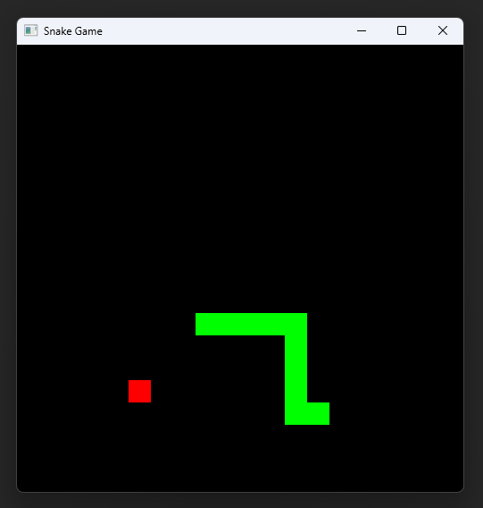

# Simple Snake Game

Just a simple Snake game built with C++20 and CMake.

## Screenshot



## Controls

**Arrow Keys** ($\uparrow$, $\downarrow$, $\leftarrow$, $\rightarrow$) — Move the snake

## Requirements

- **C++ Standard:** C++20
- **Build System:** CMake (3.25 or higher)

## Building

To build the project, you type the following in the terminal:

```bash
cmake -B build
cmake --build build
```

## Tested Configurations

The game was checked and built successfully on Windows using generators `Ninja` and `Visual Studio`, with `MSVC` and `Clang` compilers.

## License

This project is licensed under the [MIT LICENSE](LICENSE).
